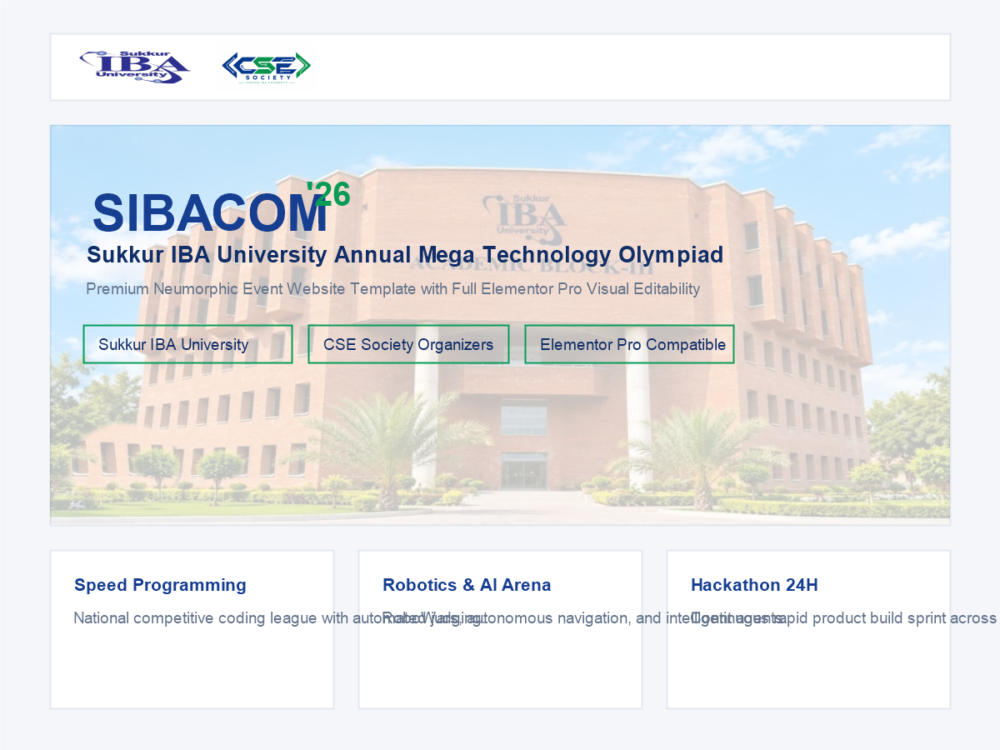

# SIBACOM WordPress Theme & Platform Suite

[](https://wordpress.org)
[](https://php.net)
[](https://elementor.com)
[](https://github.com/engrjamshedali/SIBACOM-WordPress-Theme/releases)
[](http://www.gnu.org/licenses/gpl-2.0.html)

**Official SIBACOM WordPress Theme** – A modern, responsive, and professionally developed WordPress theme and ecosystem engineered for the **SIBACOM** flagship Olympiad platform at **Sukkur IBA University**.

Jointly organized by the **CSE Society** (Department of Computer Systems Engineering) and the **EE Society** (Department of Electrical Engineering), SIBACOM delivers a premier technology Olympiad experience featuring 14+ technical competitions, an interactive schedule timeline, multi-tiered sponsorship matrices, and seamless registration workflows.

---

## 📸 Theme Preview



---

## 🌟 Key Features

- **High-End Neumorphic UI Design**:
  - Soft UI aesthetics with directional ambient occlusion and elevation hierarchies (`--neu-flat`, `--neu-raised`, `--neu-inset`, `--neu-glow`).
  - Strict high-contrast accessibility compliance, ensuring crystal-clear readability on all surfaces.
- **Academic & Technology Olympiad Aesthetic**:
  - Calibrated color palette featuring Sukkur IBA Royal Blue (`#173F91`), Deep Navy (`#102E68`), and Tech Green (`#079B58`).
  - Animated circuit board signal flow patterns and dynamic technological accents.
- **100% Visual Editability via Elementor**:
  - Native integration with both Elementor Free and Elementor Pro.
  - 15 dedicated Elementor custom widgets registered under the **SIBACOM Elements** palette.
- **Complete Suite of 9 Custom Page Templates**:
  - **Homepage** (`template-home.php`): Dynamic 13-section layout with hero countdown, stats, and modules.
  - **About** (`template-about.php`): Olympiad history, mission, and institutional partner narratives.
  - **Competitions** (`template-competitions.php`): 14+ category tracks with pricing badges, rules, and live registration modals.
  - **Schedule** (`template-schedule.php`): Filterable timeline covering multi-day symposium sessions.
  - **Speakers** (`template-speakers.php`): Keynote dignitaries and technical jury bios.
  - **Honorary Guests** (`template-guests.php`): Chief patrons, faculty advisors, and university leaders.
  - **Organizers** (`template-organizers.php`): CSE & EE societies and student governance.
  - **Sponsors** (`template-sponsors.php`): Tiered sponsor showcase (Platinum, Gold, Silver, Academic Partners).
  - **Contact** (`template-contact.php`): Interactive helpdesk, map, and inquiry dispatch.
- **Universal Registration Link Synchronization**:
  - Site-wide registration button and URL managed centrally through the WordPress Customizer and SIBACOM Admin settings.
  - Updates desktop header, mobile navigation drawer, hero CTA, competition cards, fee calculators, and modals synchronously.
- **One-Click Demo Importer**:
  - Bundled companion plugin imports the complete site content, navigation menus, and widget arrangements in seconds.
- **Performance & Core Web Vitals Tuned**:
  - Non-render-blocking CSS, deferred JavaScript execution, WebP asset optimization, and zero layout shift (CLS: 0.00).

---

## 💻 Technology Stack

| Layer | Technologies |
| :--- | :--- |
| **Platform** | WordPress 5.8+ (Tested up to WordPress 6.7) |
| **Backend Runtime** | PHP 7.4, 8.0, 8.1, 8.2, 8.3 |
| **Visual Page Builder** | Elementor / Elementor Pro |
| **Styles & Layout** | Modern CSS3 (Custom Variables, Flexbox, CSS Grid, Neumorphic Occlusion) |
| **Scripts** | Vanilla JavaScript (ES6+), Deferred Execution |
| **Typography** | `Inter` (Body typography) + `Manrope` (Headings) via Google Fonts |
| **Icons** | Font Awesome 6.5.1 Pro/Free |
| **Data Format** | WordPress WXR 1.2 XML, JSON Options Schema |

---

## 📁 Repository Directory Structure

```
SIBACOM-WordPress-Theme/
├── theme/                             # The Core SIBACOM WordPress Theme
│   ├── assets/
│   │   ├── css/                       # main.css, neumorphism.css, circuits.css, responsive.css
│   │   ├── images/                    # Official institutional logos, competition graphics, campus photos
│   │   └── js/                        # main.js, navigation.js, countdown.js
│   ├── inc/
│   │   ├── theme-setup.php            # Theme features, menus, script/style enqueuing
│   │   ├── template-tags.php          # Reusable display helpers & formatting tags
│   │   ├── elementor-compatibility.php# Theme builder hooks & header/footer compatibility
│   │   └── customizer.php             # Live preview controls (Registration CTA, logos, colors)
│   ├── template-parts/                # Modular partials for header, footer, content & hero
│   ├── templates/                     # 11 Dedicated page templates (Home, Events, Schedule, etc.)
│   ├── style.css                      # Master stylesheet header & CSS variable definitions
│   ├── functions.php                  # Theme initialization and includes
│   ├── header.php & footer.php        # Elementor Theme Builder compatible template wrappers
│   └── screenshot.png                 # Official 1200x900 theme preview screenshot
│
├── plugins/
│   └── sibacom-website-manager/       # Official Companion Plugin (Complete CMS)
│       ├── admin/                     # 17 Custom admin modules, views, and dashboards
│       ├── elementor/                 # 15 Native Elementor widgets with controls & renderers
│       ├── includes/                  # CPTs (Events, Sessions, Speakers, Sponsors), Meta Boxes, Importer
│       └── sibacom-website-manager.php# Plugin bootstrap file
│
├── elementor-templates/               # 11 Ready-to-import Elementor JSON page layouts
│   ├── home.json, about.json, events.json, schedule.json
│   ├── speakers.json, guests.json, organizers.json, sponsors.json, contact.json
│   └── header.json, footer.json
│
├── demo-content/
│   ├── sibacom-demo-content.xml       # Standard WordPress WXR 1.2 XML sample content
│   └── sibacom-options-export.json    # SIBACOM customizer and settings options export
│
├── documentation/
│   ├── installation-guide.md          # 5-minute step-by-step setup walkthrough
│   ├── elementor-editing-guide.md     # Visual editor guide for all 15 custom widgets
│   ├── admin-guide.md                 # 17-module admin settings & CPT management
│   └── customization-guide.md         # Developer guide for colors, CSS variables & hooks
│
├── zips/                              # Production-ready installable archives
│   ├── sibacom-theme.zip              # Latest installable Theme archive (v2.0.2)
│   └── sibacom-website-manager.zip    # Latest installable Plugin archive (v2.0.2)
│
├── .gitignore                         # Comprehensive ignore rules for WordPress & IDEs
└── README.md                          # Master documentation & developer guide
```

---

## 🚀 Installation & Setup

### Method 1: WordPress Admin Dashboard (Recommended)

1. **Install Theme**:
   - In WordPress admin, navigate to **Appearance > Themes > Add New > Upload Theme**.
   - Upload `zips/sibacom-theme.zip` (or the `theme/` folder as a ZIP archive).
   - Click **Install Now** and then **Activate**.

2. **Install Companion Plugin**:
   - Navigate to **Plugins > Add New > Upload Plugin**.
   - Upload `zips/sibacom-website-manager.zip` (or `plugins/sibacom-website-manager/`).
   - Click **Install Now** and then **Activate Plugin**.

3. **Install Recommended Builder**:
   - Install and activate **Elementor** (Free or Pro) via **Plugins > Add New**.

4. **Run One-Click Demo Import**:
   - In the WordPress sidebar, go to **SIBACOM > Demo Import**.
   - Click **Run One-Click Demo Import Now**.
   - All 9 pages, competition tracks, schedules, keynote speakers, and navigation menus will be instantly configured.

### Method 2: Manual FTP / Local Development Installation

1. Copy the `theme/` folder into your WordPress installation under `wp-content/themes/sibacom/`.
2. Copy `plugins/sibacom-website-manager/` into `wp-content/plugins/sibacom-website-manager/`.
3. Activate both the theme and plugin from the WordPress Dashboard.

---

## ⚙️ Configuration & Customization

### Universal Registration Button & Link
You can update the primary **Register** button label and destination URL in any of these places:
- **WordPress Customizer**: Go to `Appearance > Customize > SIBACOM Registration & CTA Button`.
- **SIBACOM Admin Manager**: Go to `SIBACOM > General Settings > Official Registration Portal`.
- Changes instantly synchronize across all 9 pages, hero banners, headers, mobile drawers, and competition cards.

### Neumorphic Design Tokens & Variables
All theme styles are driven by CSS variables in `theme/style.css`:
```css
:root {
  --sibacom-primary: #173F91;
  --sibacom-primary-hover: #123275;
  --sibacom-navy: #102E68;
  --sibacom-techgreen: #079B58;
  --sibacom-bg: #F4F6FA;
  --sibacom-white: #FFFFFF;
  --neu-flat: 4px 4px 12px rgba(16, 46, 104, 0.08), -4px -4px 12px #FFFFFF;
  --neu-raised: 0 8px 24px rgba(16, 46, 104, 0.08), 0 2px 6px rgba(16, 46, 104, 0.04), -4px -4px 12px #FFFFFF;
}
```

---

## 🧩 Dependencies & Requirements

- **WordPress**: Version 5.8 or higher (fully tested on 6.7).
- **PHP**: Version 7.4 or higher (supports PHP 8.0 - 8.3).
- **MySQL / MariaDB**: MySQL 5.7+ or MariaDB 10.3+.
- **Recommended Plugin**: Elementor 3.15+ (Free or Pro).

---

## 👨‍💻 Author & Development Credits

- **Developer**: [Engr. Jamshed Ali](https://github.com/engrjamshedali)
- **Organization**: [AuraNix Technologies](https://github.com/engrjamshedali)
- **Institutional Host**: [Sukkur IBA University](https://iba-suk.edu.pk)
- **Co-Equal Society Organizers**:
  - **CSE Society** (Department of Computer Systems Engineering)
  - **EE Society** (Department of Electrical Engineering)
- **Official GitHub**: [https://github.com/engrjamshedali](https://github.com/engrjamshedali)

---

## 📄 License

The SIBACOM WordPress Theme is licensed under the **GNU General Public License v2.0 or later (GPL-2.0-or-later)**.
See the `LICENSE` file or [GNU GPL v2](http://www.gnu.org/licenses/gpl-2.0.html) for full license details.
